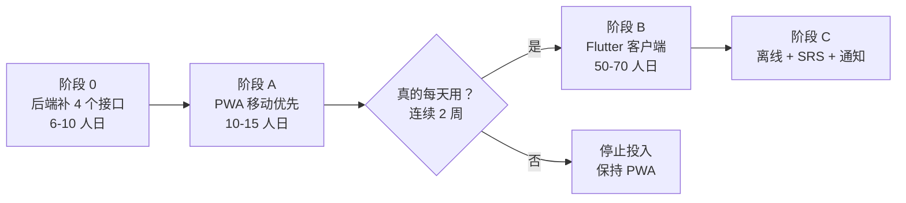
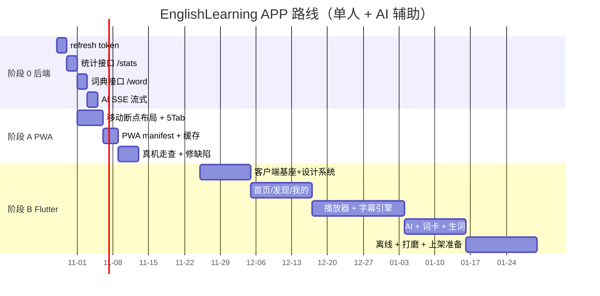

# EnglishFlow 移动 APP — 资料评估 · 开发 SPEC · 计划 · UI · 测试与审核策略

| 项 | 值 |
| --- | --- |
| 文档类型 | 评估报告 + 可执行规格 |
| 版本 | v1.0 |
| 日期 | 2026-10-27 |
| 评估对象 | `C:\Users\1\WorkBuddy\2026-10-26-20-57-24\EnglishFlow\docs`（16 份，约 320 KB） |
| 落地对象 | NASPilot 仓库 `backend/app/api/v1/english.py` 等（已实现的后端） |
| 结论预览 | 资料**可用但需降维**：UX/UI/QA 三份质量很高可直接作为契约；架构与计划严重超出本项目规模，必须重估 |

---

## 0. 报告摘要（先看这一页）

### 0.1 三个核心结论

**结论一：那批文档有用，但只能"拆着用"。**

16 份文档质量差异极大，按可用性分四档：

| 档位 | 文档 | 判断 |
| --- | --- | --- |
| **可直接作为契约使用**（改数字即可） | `05-ui-contract.md`、`06-design-system.md`、`04-ux-specification.md`、`03-information-architecture.md` | ★★★★★ 唯一标准级别的质量，逐页逐组件给了尺寸/字号/颜色。**这是本次评估最大的收获** |
| **方法论可用，内容需重写** | `12-qa-specification.md`、`12 -> 01-charter`、`02-prd.md` | ★★★★ 质量门禁、缺陷分级、测试矩阵可以直接搬；但用例数量（420 条）、设备矩阵（20 台）、团队规模全要按 1/10 压缩 |
| **架构思路可用，技术假设全错** | `11-mobile-architecture.md`、`08-naspilot-integration-contract.md`、`07-backend-architecture.md`、`09-database-specification.md`、`10-ai-engine-specification.md` | ★★ 分层架构、状态管理、字幕同步算法可借鉴；但它假设的 HLS、播放票据、SSE 流式、独立 BFF、PG/Redis/Kafka **在后端一个都不存在**，见 §2.3 |
| **不可用** | `14-roadmap.md`、`15-development-backlog.md` | ✗ 假设 60+ 人团队、1051 SP、16 周。本项目真实产能是"1 人 + AI"，必须整体重写（本文 §6 已重写） |

**结论二：真正的瓶颈不在 APP，在后端缺 6 个接口。**

APP 侧最大的风险不是 Flutter 写不出来，而是**功能设计依赖的数据后端根本没有**：

| APP 页面 | 依赖能力 | 后端现状 | 影响 |
| --- | --- | --- | --- |
| 我的 → 热力图 / 连续天数 | 用户统计接口 | ❌ 表有数据、**无接口** | 「我的」页只能显示 home.stats 的 4 个数字，热力图做不出来 |
| 播放器 → 点词查义 | 词典查询接口 | ❌ 只有课程级 300 词，**任意词查不到** | 「点词卡」这个核心卖点无法实现 |
| 生词本 → 复习 | 用户生词 + SRS | ❌ 完全不存在（无表、无接口） | 只能"看课程词表"，不能"复习我的词" |
| 任意页 → 会话保持 | refresh token | ❌ JWT 24h，**无刷新** | 用户第二天打开就要重输密码（P0 体验事故） |
| AI 老师 | SSE 流式 | ❌ 一次性返回 | 长回答等 3–15 秒白屏，用户以为卡死 |
| 字幕双语 | 中文字幕数据 | ❌ 库里只有 `.en.srt` | 「双语模式」四态中的中文态是空的 |

**结论三：先做 PWA 验证，再做原生，是当前性价比最高的路径。**

现有 Web 端 `frontend/src/pages/english/EnglishCenter.tsx`（1028 行）**已经有可用的播放器 + 逐句字幕 + 词表**。用 PWA 能复用约 70% 的这层资产，2–3 周就能在手机上真正用起来；而 Flutter 从零开始，保守 10–14 周。

建议：**阶段 A 做 PWA（验证使用习惯）→ 阶段 B 做 Flutter（追求体验）**，决策点在 §6.4 给了明确的触发条件。

### 0.2 一眼看完的推荐路线



### 0.3 工作量重估对照

| 项 | EnglishFlow 文档 | 本项目现实 | 倍数 |
| --- | ---: | ---: | ---: |
| 团队 | 60 人（Mobile 16 / Backend 16 / AI 6 / QA 6 / DevOps 3 / UX 10 / Data 3） | 1 人 + AI 辅助 | ×60 |
| 周期 | 16 周 | 阶段 A 3 周 / 完整 Flutter 12–16 周 | — |
| Story Point | 1,051 SP | 约 130–160 SP 等效 | ÷7 |
| P0 测试用例 | 420 条 | 60–80 条 | ÷6 |
| 设备矩阵 | 20 台真机 | 5–6 台 | ÷3.5 |

---

## 1. 资料盘点（逐文件评估）

评估维度：**对 APP 的相关性**（是否涉及移动端）× **内容可信度**（是否与本项目后端一致）× **可执行性**（是否能直接变成代码/用例）。

### 1.1 高价值：可直接改用（四份）

#### `05-ui-contract.md`（30 KB）— ★★★★★ 本次最有价值的文件

**为什么价值最高**：它不是"设计建议"，而是**逐 Section、逐像素、带禁止项的契约**，天然适合作为验收标准。抽样：

| 内容 | 具体到什么程度 |
| --- | --- |
| 基线尺寸 | 390×844 dp、页面边距 20、Section 间距 28、最小点击区 44×44、4 列栅格 gutter 12 |
| Tab Bar | 高 56 + 安全区、图标 24、文字 10/500、切换动效 scale 1.0→1.08→1.0（180ms） |
| 播放器三段式 | A 顶部（封面 200×200 圆角 20、课程名 22/600、频道 13）／B 控制（进度条 4dp、主按钮 64 圆形、快进快退 32）／C 字幕（当前句 20/600 白色、相邻 15/0.40、更远 13/0.20、句间距 18、滚动 180ms） |
| 词卡 | 底部 Sheet、高 45%、**不暂停播放**、单词 24/600 + 音标 14 + 释义 15 + 原句高亮 |
| 状态矩阵 | 加载/缓冲/暂停/结束/无字幕/后台/断网 七态逐条给了表现 |
| 禁用词红线 | 文件/路径/磁盘/NAS/扩展名/码率/服务器地址/错误堆栈，**任一界面出现即 P0** |

**可直接沿用**：§1 全局契约、§2–§7 六页契约、§5 播放器、§8 组件契约、§9 Design QA 清单。
**必须修改**：§5.5 双语字幕（库里没有中文，见 §2.3-7）、§5.9 引导式 5 步（跟读/测验后端无能力，砍到 3 步）、§6 AI 引用跳转（无 citation 数据）。

#### `06-design-system.md`（16 KB）— ★★★★★

给了完整的 token：品牌色 `#2563EB`、播放器强调色 `#F59E0B`、中性色（浅/深）、字阶、8pt 间距节奏、圆角、阴影、动效曲线、字幕专用字阶、图标语义表、卡片规范、深色模式、A11y 对比度。

**唯一要注意**：这套 token 与现有 Web 端（antd 默认 + 自定义）**不完全一致**。建议 APP 直接采用本 DS，并反向把 Web 端颜色对齐，否则两端观感割裂。

#### `04-ux-specification.md`（15 KB）— ★★★★☆

用户旅程、Task Flow（含异常分支）、学习流程、SRS 节奏、手势规范、三态规范、文案语气。**手势与三态规范最有价值**（可直接写进 Widget 测试断言）。

**需裁剪**：§5.4 12 周职场路径（后端无路径概念）、§4.4 订阅转化（无支付）。

#### `03-information-architecture.md`（14 KB）— ★★★★☆

一级导航、实体字典、页面层级、深链规范、状态保持。**深链规范可直接用**（`englishflow://lesson/{id}?t=83`）。

### 1.2 中价值：方法论可用，内容要重写（三份）

#### `12-qa-specification.md`（14 KB）— ★★★★☆

可搬：质量方针（质量内建/门禁刚性/左移右移）、**缺陷四级定义与响应时限**、**缺陷单必填模板**、**Go/No-Go 12 项清单**、线上监控阈值表、AI 评测流程。
要改：P0 用例 420 条 → 60–80；设备 20 台 → 6 台；性能门禁全部按真实硬件下调（见 §7.5）。

#### `02-prd.md`（33 KB）— ★★★☆☆

EARS 格式的功能需求、用户故事、埋点需求、指标口径。**埋点与指标口径章节可直接用**。
要改：订阅/IAP、水平测试、学习路径三大块后端不存在，MVP 必须剔出。

#### `01-project-charter.md` / `00-organization.md`

组织架构是虚构的 60 人公司，**对本项目零价值**。但 Charter 里的"边界声明"（什么不做）思路可借鉴。

### 1.3 低价值：技术假设全错（五份）

#### `11-mobile-architecture.md`（22 KB）— ★★☆☆☆

**可借鉴**（约 30%）：
- 分层架构与依赖规则（presentation → domain ← data），可直接落成 lint 规则
- Riverpod 状态分层 + `select` 精准订阅
- **`SubtitleSyncEngine` 的二分查找 + 防抖算法**（见 §4.4.2，这是全文档最有技术含量的一段）
- 缓存三级分层、进度上报触发点、启动优化（critical/deferred 两段式）
- 错误分类与降级表

**必须推翻**（约 70%）：
- HLS + 播放票据 → 实际是 **HTTP Range 直出 MP4**
- `audio_service` + HLS 后台播放 → 实际是逐字节流，需另做方案
- Drift + 加密离线包（AES-256-GCM）→ 实际无离线包接口，内网自用不需要加密
- Sentry、Firebase Test Lab、自建埋点 SDK → 全部超配

#### `08-naspilot-integration-contract.md`（20 KB）— ★☆☆☆☆

文档定义了一整套 `/v1/courses`、`/v1/playback/tickets`、`/v1/lexicon/{lemma}`、`/v1/sync/changes`、Webhook。

**现实**：NASPilot 暴露的是 `/api/english/*`（别名，专为 Flutter 契约而留），路径、字段、鉴权方式**全部不同**。这份文档可以当"未来演进方向"看，**不能当实现依据**。

唯一可用的部分：§5.2 字幕质量硬性契约、§11 内容准入质检流程（可直接做成脚本，见 §7.4）。

#### `07-backend-architecture.md` / `09-database-specification.md` / `10-ai-engine-specification.md` — ★☆☆☆☆

假设 PG + Redis + Kafka + 独立 BFF + RAG 向量库。
**现实**：SQLite（单文件）+ FastAPI + APScheduler，无 Redis、无消息队列、无向量库，AI 是一次性 HTTP 调用。

**不适用**，但 `09` 里的"实体关系与约束"思路可用来校验现有表设计。

### 1.4 无价值（两份）

`14-roadmap.md`、`15-development-backlog.md`：60 人团队、16 周、1051 SP、S1–S8 冲刺。**整体作废**，本文 §6 已按真实产能重写。

---

## 2. 与真实后端的能力差距分析（本报告核心）

### 2.1 已具备、可直接支撑 APP 的能力

实测确认（`backend/app/api/v1/english.py`）：

| 能力 | 接口 | 说明 |
| --- | --- | --- |
| 首页聚合 | `GET /api/english/home` | 一次返回 greeting / user / stats / continue_learning(6) / recent(8) / recommended(8) |
| 课程列表 | `GET /api/english/courses` | 支持 q/channel/level/topic/skill/format/favorite/sort/page |
| 课时列表（跨课程） | `GET /api/english/lessons` | 同维度筛选，**按单文件分类过滤** |
| 筛选项 | `GET /api/english/filters` | 含 `lesson_filters`（课时级真实分布） |
| 课程详情 | `GET /api/english/course/{id}` | 含课时列表 + 每课时 level/topics/skills/format |
| 课时详情 | `GET /api/english/lesson/{id}` | 含 stream_url / subtitle_url / progress / vocabulary(40) / bookmarks / prev / next |
| 字幕 | `GET /api/english/transcript/{id}` | `segments[{i, start, end, text, spk}]`，**毫秒**时间戳 |
| 生词（课程级） | `GET /api/english/vocabulary/{course_id}` | 最多 300 词，含 kind/frequency/difficulty/meaning |
| 搜索 | `GET /api/english/search` | 字幕全文（LIKE） |
| 进度 | `POST /api/english/progress` | `{lesson_id, position(秒), listen_seconds, completed}` |
| 句书签 | `POST /api/english/bookmark` | `{lesson_id, position(句号), at_seconds, note, text, remove}` |
| 收藏 | `POST /api/english/favorite` | `{course_id, favorite}` |
| 媒体流 | `GET /api/media/{lesson_id}` | **Range/206**，支持 `?token=`，也可用 Bearer 头 |
| 字幕原文 | `GET /api/subtitle/{lesson_id}` | |
| 封面 | `GET /api/stream/cover/{course_id}` | 需鉴权（**注意：`cached_network_image` 必须带 header**） |
| AI | `POST /api/english/ai/chat`、`/explain`、`/summary` | 非流式 |
| AI 状态 | `GET /api/english/ai/status` | 未配置时可禁用按钮 |
| 鉴权 | `POST /api/v1/auth/login`、`GET /api/v1/auth/me` | JWT HS256，**24h，无 refresh** |

> 代码注释原文：`Flutter keeps using the header.` —— 说明后端从设计起就是为 Flutter 客户端准备的，`/api/english/*` 别名即"Flutter 客户端契约"。

### 2.2 缺失能力清单（按阻塞程度排序）

#### P0-1 会话保持（阻塞"能不能用"）

| 项 | 现状 |
| --- | --- |
| Token | JWT HS256，`ACCESS_TOKEN_EXPIRE_MINUTES = 1440`（24h） |
| 刷新 | **不存在** |
| 影响 | 通勤场景：第 2 天早上打开 APP → 401 → 回登录页 → 重新输入账号密码。这是**留存杀手** |

**建议方案**（择一，推荐 A）：

| 方案 | 做法 | 成本 | 评价 |
| --- | --- | --- | --- |
| **A. Refresh token**（推荐） | 新增 `POST /api/v1/auth/refresh`，签发 30 天 refresh token（httpOnly 不适用，移动端存 Keychain/Keystore）；access 仍 24h | 后端 2 人日 + 客户端 1 人日 | 标准做法，安全 |
| B. 移动端专用长效 token | 登录时传 `device=mobile`，签发 30 天 access | 0.5 人日 | 简单但 token 泄露即长期失守 |
| C. 客户端存密码自动重登 | 不安全 | — | ✗ 不采用 |

#### P0-2 用户统计接口（阻塞「我的」页）

| 项 | 现状 |
| --- | --- |
| 表 | `learning_statistics(EnglishDailyStat)` 已存在：`user_id / day / listen_seconds / ...` |
| 接口 | **不存在**。`home.stats` 只给 4 个总数 + 今日分钟 |
| 影响 | 热力图、7 日趋势、连续天数、本周报告全做不出来 |

**建议新增**：

```
GET /api/english/stats?days=90
→ {
    "streak": 5,                       // 连续学习天数
    "today_seconds": 1830,
    "week": [{"day":"2026-10-21","seconds":1200}, ...],
    "heatmap": [{"day":"2026-07-30","seconds":0}, ...],   // 90 天
    "totals": {"lessons_completed": 12, "listen_seconds": 84200, "words": 96},
    "levels": {"A1":2,"A2":54,"B1":98,"B2":17,"C1":1}       // 已学分布
}
```

成本约 1.5 人日（纯聚合查询，数据已就绪）。

#### P0-3 词典查询接口（阻塞「点词卡」核心卖点）

| 项 | 现状 |
| --- | --- |
| 词表 | `EnglishVocabulary` 是**课程级**的，由扫描时提取 + AI 补 `meaning` |
| 任意词查询 | **不存在** |
| 影响 | UI Contract §5.6 要求点任意单词显示「音标 + 词性/释义 + 发音」，无数据来源 |

**三条路径**：

| 方案 | 做法 | 成本 | 质量 | 评价 |
| --- | --- | --- | --- | --- |
| **A. AI 按需解释**（推荐先行） | `POST /api/english/word` → 调现有 `ai_service`，要求返回 JSON `{word, phonetic, pos, meaning_zh, example}`；按 `word+lesson` 缓存到表 | 2 人日 | 中（可能幻觉音标） | 零外部依赖，与现有 AI 复用；加缓存后成本可控 |
| B. 内置离线词典 | 打包 ECDICT 精简版（约 5 万词，SQLite ~15 MB）到后端 | 2 人日 | 高 | 需处理版权（ECDICT 为 MIT，可用） |
| C. 三方词典 API | 有道/剑桥 | 1 人日 | 高 | 引入外网依赖 + 配额，内网环境不适用 |

**推荐**：先 A（1 周内可用），若查词量大再补 B 作为离线兜底。**注意：音标用 AI 不可靠，B 才是终态**。

#### P1-1 AI 流式（SSE）

现状：`/ai/chat` 一次性返回。AI 生成长回答 3–15 秒，用户看到的是白屏 + loading。

**建议**：FastAPI `StreamingResponse(media_type="text/event-stream")`，复用现有 `ai_service` 的流式能力（若底层是 OpenAI 兼容接口则天然支持 `stream=True`）。成本 1.5 人日。客户端 1 人日。

价值极高：AI 页的体感差异是"秒回"vs"卡死"。

#### P1-2 用户生词本 + SRS（阻塞「复习」）

现状：无表、无接口。只有课程词表可"看"。

**建议新增**：

```
EnglishUserWord (user_id, word, lemma, course_id, lesson_id, added_at,
                 box, ease, due_at, correct_count, wrong_count)
POST /api/english/words            # 加词
GET  /api/english/words?due=1      # 待复习队列
POST /api/english/words/review     # {word, grade: 0|1|2|3}  → SM-2 简化
DELETE /api/english/words/{word}
```

成本：后端 4 人日 + 客户端 3 人日。**MVP 可先只做"加词 + 列表"，SRS 放 V1**。

#### P1-3 中文字幕（阻塞「双语模式」）

现状：媒体库里只有 `<name>.en.srt`，共 397 个英文字幕文件，**无中文**。

| 方案 | 说明 | 成本 | 评价 |
| --- | --- | --- | --- |
| A. 砍掉双语 | UI 只保留「英文/隐藏」两态；中文改为「点句翻译」（AI 按需） | 0 | **MVP 推荐**：交互更轻，且不会出现大量未翻译的空白 |
| B. 离线批量机翻 | 扫描时对每课时调用 AI 批量翻译，存 `transcript.zh_segments` | 每课 1 次 AI 调用 × 398 课，成本高、质量不稳 | 不推荐一次性做 |
| C. 按需 + 缓存 | 用户切到双语时，按当前课时请求翻译（一次一课时，约 100 句） | 1.5 人日 | V1 可选 |

#### P2 其它

- **AI 引用/跳转**：无 citation 数据，UI Contract §6 的"引用卡片 + 跳转"做不了。建议 MVP 移除，改为"相关句推荐"（用 `/search` 实现）。
- **发音音频**：词卡"发音按钮"无 TTS。可用系统 TTS（`flutter_tts`）本地合成，零后端成本。
- **学习路径/阶段**：无概念。可用 `level` + `course.lesson_count` 生成伪路径（A2→B1→B2 三段），纯客户端逻辑。
- **离线包**：无接口。客户端可用 Range 直接整包下载 mp4 + transcript JSON。**现实体积**：单课时 mp4 约 15–47 MB，18 GB 全库；建议配额 5 课时（~200 MB）。

### 2.3 与 EnglishFlow 文档假设的冲突（必须明确放弃的部分）

| # | 文档假设 | 现实 | 处理 |
| --- | --- | --- | --- |
| 1 | HLS + `POST /v1/playback/tickets` + 票据续签 | HTTP Range 206 直出 MP4，鉴权用 Bearer 头 | **改写 §7.2**：`just_audio` 用 `AudioSource.uri(uri, headers: {Authorization})` 播放；无 HLS → 无自适应码率，弱网靠预缓冲 |
| 2 | SSE 流式 AI + 引用 | 一次性 JSON，无 citation | §2.2 P1-1 补流式；引用从 MVP 移除 |
| 3 | 双语字幕（英 + 中） | 只有英文 | 改「英文 / 隐藏」两态 + 点句 AI 翻译 |
| 4 | 订阅 + IAP + 权益门禁 | 无任何支付 | **全删**。离线配额改为本地限制（自由设定） |
| 5 | 加密离线包 AES-256-GCM + 设备绑定 | 无离线接口，内网自用 | 简化：明文缓存 + 应用私有目录，不做加密 |
| 6 | 水平测试 / Onboarding 分级 | 无接口 | 改为「选一个难度开始」（用 `/filters` 的 levels），不叫"测试" |
| 7 | 学习路径 12 周 + 阶段 | 无概念 | 伪路径（客户端按 level 排序生成） |
| 8 | 广场/热门/Trending | 无推荐算法 | 用 `home.recommended`（按 lesson_count 排序）冒充"热门"，诚实标注 |
| 9 | 独立 BFF + PG + Redis + Kafka | 单进程 FastAPI + SQLite | 客户端直连 `/api/english/*` |
| 10 | 20 台真机 + Firebase Test Lab | 无预算 | 6 台自持设备 + 内测群 |
| 11 | 60 人团队 / 1051 SP | 1 人 + AI | 全面重估（§6） |
| 12 | 每日推送 / 成就系统 | 后端有 `notifications`（仅渠道 + 记录，无设备 token） | 推送移到 V2；MVP 用本地通知（`flutter_local_notifications`） |

### 2.4 并发硬约束：长连接不能占用数据库事务（实测踩坑，APP 必读）

这一条对 APP 比对 Web 更重要，因为播放器会比网页时代更频繁、更长时间地持有连接。

**现象**：网页端把某一课暂停着放了一晚上，第二天登录接口返回 500，耗时恰好 15.04 秒（`busy_timeout` 上限）。

**根因链**：

1. 媒体流是 HTTP Range 长响应，暂停时连接**不会结束**（浏览器/播放器保持连接以便续播）；
2. FastAPI 的 `yield` 依赖（`get_db`）要等**响应体发送完毕**才释放；
3. 于是整个暂停期间，该请求的 `AsyncSession` 一直活着，事务一直是开的；
4. 若事务用 `BEGIN IMMEDIATE` 开启（为保证写操作不因"快照升级"瞬间失败而采用），
   它会持有 SQLite 的**写锁**；
5. 结果：进程内所有写操作（登录、进度上报、扫描）全部排队到 `busy_timeout` 后失败。

**修复（已在后端落地，APP 侧需知悉）**：

| 措施 | 作用 |
| --- | --- |
| 引擎默认**延迟事务** | 只读请求（含未写前的扫描）不占写锁，长连接无副作用 |
| 提供 `begin_write(db)` | 真正要"先读后写"的地方显式 `BEGIN IMMEDIATE`，只锁毫秒级 |
| 流接口在返回响应**之前** `await db.rollback()` | 事务与数据库连接立即归还连接池，不再跟着响应体存活 |
| AI 接口在调用模型**之前** `await db.commit()` | 模型耗时数秒，不能顺带锁库 |

**对 APP 的直接影响（必须遵守）**：

1. 播放器**不要**做高频轮询（轮询会抢占 `pool_size`）；进度上报走 §4.4.5 的节奏。
2. 同一页面不要同时打开多个媒体流（封面 + 视频 + 字幕原文已经是 3 个连接）。
3. 客户端应设置 `pool` 上限意识：后端 `pool_size` 默认 5，**同时挂起的连接超过 5 个就会排队**。
   建议 APP 侧：封面用磁盘缓存、字幕只请求一次并落库、避免"列表页把每张封面都拉一遍"。
4. 收到 401 时不要自动重试风暴（会放大连接占用），按 §4.5 静默跳登录。

> 实测（修复后）：保持一个暂停的流 + 全量重扫 398 课时 + 并行 60 次登录 → **60/60 成功，0 次 `database is locked`，0 条 ERROR**。空闲扫描 0.7 秒。

---

## 3. 客户端技术选型评估

### 3.1 决策矩阵

| 维度（权重） | Flutter | React Native | PWA / Capacitor（复用现有 React） | 原生双端 |
| --- | ---: | ---: | ---: | ---: |
| 复用现有 Web 代码（20%） | 0 | 3 | **5** | 0 |
| 字幕滚动性能（20%） | **5** | 3 | 3 | 5 |
| 后台音频 + 锁屏控制（20%） | **5** | 4 | 2 | 5 |
| 学习成本（15%） | 2 | 4 | **5** | 1 |
| 离线能力（10%） | 4 | 3 | 2 | 5 |
| 双端一致（10%） | **5** | 4 | 5 | 1 |
| 上架可行性（5%） | 4 | 4 | 3 | 4 |
| **加权总分** | **3.70** | 3.55 | **3.60** | 2.80 |

Flutter 与 PWA 分数接近，但性质不同：**PWA 赢在"立刻能用"，Flutter 赢在"用得久"**。

### 3.2 推荐：两阶段

#### 阶段 A — PWA（2–3 周，先验证）

| 项 | 内容 |
| --- | --- |
| 做法 | 现有 `EnglishCenter.tsx` 增加移动断点布局（< 768px 切单列 + 底部 5 Tab）+ `manifest.json` + Service Worker 预缓存字幕 |
| 复用 | 播放器逻辑、字幕解析、词表渲染、全部 20 个 API 调用 |
| 能实现 | 首屏/发现/我的/播放器/字幕逐句/词表/收藏/进度 |
| 做不到 | iOS 后台音频（Safari 会挂起）、锁屏控制、真正离线 |
| 交付 | 手机浏览器「添加到主屏幕」即用 |
| 风险 | iOS Safari 的 `<video>` 全屏行为与手势冲突 |

#### 阶段 B — Flutter（10–14 周，追求体验）

触发条件（**同时满足才启动**）：

1. 阶段 A 连续使用 ≥ 2 周，且完课数 ≥ 5；
2. 明确抱怨"锁屏不能听""地铁里断网就废了"；
3. 愿意投入 ≥ 8 周开发时间。

若 1 不满足 → 说明需求未被验证，**继续用 PWA，不要投入 Flutter**。

### 3.3 若做 Flutter，选型的务实调整

对 `11-mobile-architecture.md` §2 的修正：

| 领域 | 文档选型 | 修正 | 理由 |
| --- | --- | --- | --- |
| 状态管理 | Riverpod 2.5 | ✅ 保留 | 编译期安全、可测 |
| 路由 | go_router 14 | ✅ 保留 | 深链必要 |
| 网络 | Dio | ✅ 保留 | 拦截器必需（token 注入、401 重登、错误映射） |
| 音频 | just_audio + audio_service | ✅ 保留（**但源改为 Range MP4**） | `just_audio` 支持 headers；`audio_service` 负责锁屏 |
| 本地 DB | Drift | ⚠️ 降级为 `sqflite` 或 `shared_preferences` + 文件 | 只有 4 张表（缓存/进度队列/事件队列/离线索引），Drift 的 build_runner 成本不划算 |
| 序列化 | freezed + json_serializable | ⚠️ 可用 `json_serializable` 纯手写 model | 少一层代码生成 |
| 崩溃 | Sentry | ❌ 移除 | 内网自用，改为本地日志文件 + 导出 |
| 埋点 | 自建 SDK | ❌ 移除 | 改为本地 SQLite 记录关键事件，不做上报 |
| 图表 | fl_chart | ✅ 保留（热力图） | 轻量 |
| 图片 | cached_network_image | ⚠️ 注意：封面接口需鉴权 → 必须自定义 `httpClient` 注入 header | 否则封面全 401（这是 Web 端踩过的同一个坑） |
| 测试 | flutter_test + mocktail + patrol | ⚠️ 保留 flutter_test + mocktail，patrol 可选 | |

---

## 4. APP 开发 SPEC（可直接照着写代码）

### 4.1 产品定位与红线

**定位**：一个**英语学习播放器**，不是视频播放器，也不是 NAS 客户端。

**红线（任何界面、任何弹层、任何文案均禁止出现）**：

1. 文件 / 文件夹 / 目录 / 路径 / 磁盘 / 存储位置 / 容量明细（仅允许"已用 1.2 GB"总量）
2. NAS / SMB / NFS / 媒体库 / 扫描 / 刮削 / 导入 / 下载任务队列
3. 文件扩展名（.mp4/.mp3/.srt）、编码（H.264/AAC）、码率、分辨率
4. 服务器地址 / IP / 内部服务名 / 错误堆栈
5. 「资源管理」「内容管理」「库管理」

> 验收方式：对 `lib/**/*.dart` 中的字符串常量做关键词扫描，命中即 P0。脚本见 §8.2.3。

### 4.2 信息架构与路由表

```
Tab 1 首页 ─┬─ 课时播放器（push，全屏）
            └─ 课程详情（push）
Tab 2 发现 ─┬─ 课程详情
            └─ 课时播放器
Tab 3 学习 ─┬─ 课程详情
            └─ 课时播放器
Tab 4 AI 老师 ── （无子页，深链可带 lessonId）
Tab 5 我的 ─┬─ 我的生词
            ├─ 学习统计
            ├─ 我的收藏
            ├─ 已下载（离线）
            └─ 设置
```

**路由常量**（go_router）：

| 路径 | 页面 | 参数 | 数据来源 |
| --- | --- | --- | --- |
| `/` | 首页 | — | `GET /home` |
| `/discover` | 发现 | `?level&topic&skill&format&q` | `GET /courses` + `GET /filters` |
| `/learn` | 学习 | — | `GET /home`（continue_learning） |
| `/ai` | AI 老师 | `?lessonId` | `POST /ai/chat` + `GET /ai/status` |
| `/me` | 我的 | — | `GET /home`（stats）+ `GET /stats`（待建） |
| `/course/:id` | 课程详情 | — | `GET /course/{id}` |
| `/lesson/:id` | **播放器** | `?t=`（起始秒） | `GET /lesson/{id}` + `GET /transcript/{id}` |
| `/words` | 我的生词 | `?due` | 待建 |
| `/stats` | 学习统计 | — | 待建 |
| `/settings` | 设置 | — | 本地 |

深链：`naspilot://lesson/{id}?t={seconds}`（用于分享/通知点击）。

### 4.3 逐页规格

#### 4.3.1 首页

Section 顺序固定（来自 UI Contract §2.1）：

| # | Section | 数据 | 实现要点 |
| --- | --- | --- | --- |
| 1 | Greeting | **本地计算**（按设备时间）+ `home.user.name` | 05:00–11:59 Good morning / 12:00–17:59 Good afternoon / 18:00–04:59 Good evening。副文案：`home.stats` 有记录 → `You're on a {n}-day streak`（n 来自 `/stats`，无接口前显示 `Keep going`）；无记录 → `Let's start your first lesson` |
| 2 | Continue Learning | `home.continue_learning[0]` | 大卡：封面 16:9、标题、课程名、进度条、剩余时间、大字「继续」。**若数组为空 → 降级为「从这里开始」卡，取 `home.recommended[0]`** |
| 3 | Today Recommendation | `home.recommended` | 横向滑动卡片，一屏露 1.2 张 |
| 4 | Learning Topics | `GET /filters` 的 `topics` | 2×3 网格 Tile，点击带 `?topic=` 跳发现页。**失败时用本地静态 6 项兜底** |
| 5 | Recently Updated | `home.recent` | 纵向列表，最多 8 条 |

状态：骨架屏（不是 spinner）、下拉刷新、单 Section 独立重试。

#### 4.3.2 发现

结构固定：搜索框 → 四个筛选维度（难度 CEFR / 话题 / 技能 / 形式）→ 结果列表。

| 项 | 规格 |
| --- | --- |
| 搜索 | 防抖 300ms，调 `GET /courses?q=`。**字幕级搜索**（`/search`）作为结果列表的第二 Tab「搜句子」 |
| 筛选 | **多选**。`level` / `topic` / `skill` / `format` 各一组横向 chip。⚠️ 后端目前**每维度只接受单值**（`level: str`），多选需要客户端逐值请求后合并，或后端加 `level=in.(A2,B1)` 支持 |
| 排序 | `sort=recent|title|lessons` |
| 分页 | 上拉加载，`page_size=20` |
| 空态 | 「没有符合条件的课程」+「清除筛选」按钮 |

> **实现注意（踩坑记录）**：后端数组筛选用的是 `json_each`，用 LIKE 会因 `ensure_ascii` 完全失效。客户端只需按字符串传值，勿自行编码。

#### 4.3.3 学习

| Section | 内容 | 现实约束 |
| --- | --- | --- |
| 我的学习路径 | 伪路径：按 `level` 升序把「有未完成课时的课程」串成 A2 → B1 → B2 三段 | 后端无路径概念，纯客户端生成 |
| 继续学习 | `home.continue_learning` 全量（最多 6） | |
| 阶段时间轴 | 三个阶段卡片，显示各自完课数/总数 | 用 `GET /stats.levels` 统计 |
| 课程体系 | 按 channel 分组的课程网格 | `GET /courses?channel=` |

#### 4.3.4 AI 老师

结构：标题 → 上下文卡（有 lessonId 时）→ 推荐问题 → 会话流 → 吸底输入栏。

| 项 | 规格 |
| --- | --- |
| 上下文卡 | 显示当前课时标题 + 封面 + 「换一课时」。上下文自动取 `lastPlayedLessonId`（本地） |
| 推荐问题 | 无上下文 6 条通用；有上下文 3 条针对当前课时（客户端模板：`这句话什么意思？`/`这课讲了什么？`/`给我 3 个重点词汇`） |
| 请求 | `POST /ai/chat {lesson_id, question}`。**MVP 无流式** → 发送后立即插入"思考中"占位消息 + 打字动画，收到后替换 |
| 未配置 | 启动时 `GET /ai/status`，`configured=false` → 输入栏禁用 + 「AI 未配置，请管理员在系统设置中填写 API Key」（禁用词检查：不能说"后台/服务器"，用"系统设置"） |
| 引用 | **MVP 不做**（无 citation 数据）。改为回答下方固定「相关句」按钮 → 跳 `/search?q=关键词` |

#### 4.3.5 我的

| Section | 数据 |
| --- | --- |
| 用户信息 | `home.user.name` + 头像（字母圆头像，无上传） |
| 四项数据 2×2 | `home.stats`：已学课时 / 学习时长 / 今日分钟 / 完成课时 |
| 学习热力图 | **依赖待建的 `/stats`**。无接口时降级：显示「学习记录整理中」占位 |
| 功能入口 | 我的生词 / 学习统计 / 我的收藏 / 已下载 / 设置 |

#### 4.3.6 播放器（核心，见 §4.4）

### 4.4 播放器专项 SPEC（全 APP 最高风险模块）

#### 4.4.1 页面骨架（三段式，顺序不可变）

```
A 顶部：返回 / 更多（菜单）｜ 封面 200×200 圆角20 ｜ 课程名 22/600 ｜ 频道 13/0.64
B 控制：进度条(4dp) + 时间 ｜ 快退15(32) - 播放(64圆形白底) - 快进15(32) ｜ 倍速/定时/CC/循环
C 字幕：歌词模式（屏高×0.34，最小240）
```

背景：课程封面高斯模糊（radius 60）+ `rgba(15,23,42,0.72)` 遮罩；强调色 `#F59E0B`。

#### 4.4.2 字幕同步引擎（直接可用的算法）

**输入**：`/transcript/{id}` 返回的 `segments[{i, start, end, text, spk}]`，`start/end` 是**毫秒**。

**算法**（来自 `11-mobile-architecture.md` §7.3，已验证合理）：

```dart
class SubtitleSyncEngine {
  final List<Cue> cues;      // 按 start 升序，构造时断言单调递增
  int _active = -1, _stable = -1, _candidate = -1, _stableCount = 0;

  int _indexAt(int ms) {
    var lo = 0, hi = cues.length - 1;
    while (lo <= hi) {
      final mid = (lo + hi) >> 1;
      if (ms < cues[mid].startMs) { hi = mid - 1; }
      else if (ms >= cues[mid].endMs) { lo = mid + 1; }
      else { return mid; }
    }
    return _stable;          // 句间空隙：保持上一句，避免高亮闪烁
  }

  int update(int ms) {
    final c = _indexAt(ms);
    if (c == _active) { _stableCount = 0; return _active; }
    if (c == _candidate) { _stableCount++; } else { _candidate = c; _stableCount = 1; }
    if (_stableCount >= 2) { _active = c; _stable = c; }   // 连续 2 次命中才切换
    return _active;
  }
}
```

| 参数 | 值 | 原因 |
| --- | --- | --- |
| 位置轮询 | 100ms | `just_audio` `positionStream` 默认节奏 |
| 防抖阈值 | 2 次（≈120ms） | 快速 seek 时避免高亮"跳格" |
| 句间空隙 | 保持上一句 | 否则高亮消失，观感很差 |
| 提前量 | 0ms | 宁可晚 100ms 也不要早（早=剧透） |
| 用户校准 | ±500ms 隐藏入口 | 个别课时字幕有偏移 |

**渲染性能规则**（这几条决定了 55fps 能不能达到）：

1. 列表用 `ScrollablePositionedList`（行高不定，不能用 `itemExtent`）；
2. 每行 `const` + 只订阅 `isActive`（用 `ValueNotifier<int>` + `AnimatedBuilder`，**不要走 Riverpod**）；
3. 自动滚动 `animateTo(180ms)`；用户拖动时暂停跟随，3 秒后恢复；
4. 高亮只改颜色/字重（`AnimatedContainer`），**不改 padding/字号**，否则触发布局；
5. 中文副行只渲染当前句（若开双语）；
6. > 500 句时字幕分页懒加载。

#### 4.4.3 说话人分组（本库数据特有）

后端 `normalize()` 会标记 `spk: "A"|"B"`，同一个人的连续台词已合并成组。UI 必须：

- 换人处显示「说话人 A / B」小标签（11/500，`rgba(248,250,252,0.48)`）+ 24dp 额外间距；
- 同一人的连续句**不重复显示标签**；
- `spk == null`（独白）时完全不显示标签。

> 这是本库 398 课时里大量是 English Podcast 对话，不分组会"全混在一起"。

#### 4.4.4 播放引擎封装

```dart
// 关键：媒体接口需要 Bearer 头，just_audio 支持 headers
final source = AudioSource.uri(
  Uri.parse('${base}/api/media/$lessonId'),
  headers: {'Authorization': 'Bearer $token'},
);
await player.setAudioSource(source, initialPosition: Duration(seconds: startAt));
```

| 项 | 方案 |
| --- | --- |
| 音源 | HTTP MP4/AAC（Range 206）。**无 HLS** → 无自适应码率 |
| 倍速 | `setSpeed()`，`just_audio` 默认保持音高（0.5–2.0） |
| 后台播放 | `audio_service` 前台服务（Android）+ `AVAudioSession.playback`（iOS） |
| 锁屏/通知 | 课程名、频道、播放/暂停、上一句/下一句（上一句/下一句 = 按 cue 边界 seek） |
| 音频焦点 | 来电/其它 App 播放 → 自动暂停，恢复后续播 |
| 缓冲 | `just_audio` 默认缓冲；弱网时显示「缓冲中」+ 不显示 loading 环 |
| 错误分类 | 401（token 过期→静默重登并 seek 回原位）/ 404 / 410（文件已不在库）/ 超时 |
| 睡眠定时 | 5/10/15/30/45/60 分钟 + 播完本课 |
| 循环 | 关 / 单句循环（3 次/5 次/无限）/ AB 复读 |

#### 4.4.5 进度上报策略（务必照做）

| 触发 | 动作 |
| --- | --- |
| 播放中每 10 秒 | `POST /progress {position(秒), listen_seconds:+10}` |
| 暂停 | 立即上报 |
| 切后台 / 锁屏 | 立即上报 |
| 退出播放器 | **必报一次**（`WillPopScope` / `PopScope`） |
| 播放到 95% | `completed: true` |
| 离线 / 失败 | 写本地队列（`sqflite`），联网后按序补传（幂等：同一 lesson 只保留最新 position） |

> `position` 单位是**秒（float）**，不是毫秒。`listen_seconds` 是**增量**累加，不是本次时长。

### 4.5 鉴权与会话

```
1. 登录 POST /api/v1/auth/login {username, password} → {access_token, token_type}
2. 存 Keychain(iOS) / EncryptedSharedPreferences(Android)
3. 所有请求 Dio 拦截器注入 Authorization: Bearer
4. 401 → 清 token → 跳登录页（**在 P0-1 refresh 未完成前，这是唯一策略**）
5. 登录页记住用户名（不记密码）
```

**在 refresh token 落地前，必须做的缓解措施**：

- 登录页默认展开键盘、自动聚焦用户名；
- 登录成功后回到用户原本要去的页面（存 `pendingRoute`）；
- 401 时**不弹错误提示**，静默跳登录（弹窗会让用户觉得"坏了"）。

### 4.6 离线与缓存

| 层 | 存储 | 内容 | 策略 |
| --- | --- | --- | --- |
| L1 内存 | LRU Map | 当前课时字幕、首页数据 | 会话内 |
| L2 结构化 | `sqflite` | 课程列表、课时详情、字幕 JSON、进度队列 | 首页 24h、字幕 7 天、课程详情 24h |
| L3 媒体 | 应用私有目录文件 | 已下载的 mp4 | 配额 5 课时（约 200MB），LRU |

**离线下载实现**（无后端接口，纯客户端）：

```
1. 用户点「离线学习」
2. GET /lesson/{id} 拿 duration/size
3. 用 Dio 带 header 下载 GET /api/media/{id}（支持断点续传 Range）
4. 存 <appDir>/media/{lessonId}.mp4
5. GET /transcript/{id} 存本地
6. 写离线索引表 {lessonId, title, courseTitle, size, downloadedAt}
7. 播放时优先用本地文件 URI
```

**离线可用矩阵**（现实版）：

| 能力 | 离线 | 说明 |
| --- | --- | --- |
| 播放已下载课时 | ✅ | |
| 字幕跟随 / 点句 | ✅ | 本地字幕 |
| 点词查义 | ❌ | 需要 AI 或词典接口 → 提示「联网后可查」 |
| 进度记录 | ✅ | 本地队列，联网补传 |
| AI 老师 | ❌ | 明确提示 |
| 发现 / 搜索 | ❌ | 展示缓存列表 |

### 4.7 埋点（精简版）

不做上报服务，只本地记录 + 「设置 → 导出诊断日志」时附带。

必埋 12 个事件：`app_open`、`home_view`、`lesson_open`、`play_start`、`play_pause`、`seek`、`subtitle_tap`、`word_tap`、`word_add`、`ai_ask`、`progress_complete`、`offline_download`。

字段统一：`{name, lessonId?, courseId?, props:{}, ts}`。

---

## 5. UI 细节规范

### 5.1 Design Tokens（直接采用 `06-design-system.md`）

```dart
class Tokens {
  // 品牌
  static const primary   = Color(0xFF2563EB);
  static const accent    = Color(0xFFF59E0B);   // 播放器高亮/进度
  // 中性（浅色）
  static const ink       = Color(0xFF0F172A);   // 主文字
  static const inkSub    = Color(0xFF64748B);   // 次文字
  static const line      = Color(0xFFE2E8F0);   // 分隔线
  static const bg        = Color(0xFFFFFFFF);
  static const bgSoft    = Color(0xFFF8FAFC);
  // 中性（深色）
  static const inkDark   = Color(0xFFF8FAFC);
  static const bgDark    = Color(0xFF0F172A);
  static const lineDark  = Color(0xFF1E293B);
  // 语义
  static const success   = Color(0xFF10B981);
  static const warning   = Color(0xFFF59E0B);
  static const danger    = Color(0xFFEF4444);

  // 间距（8pt 基准 + 4pt 半步）
  static const s1 = 4.0, s2 = 8.0, s3 = 12.0, s4 = 16.0,
               s5 = 20.0, s6 = 24.0, s7 = 28.0, s8 = 32.0;
  // 圆角
  static const rCard = 16.0, rSheet = 20.0, rChip = 999.0;
  // 边距
  static const pageH = 20.0;      // 页面左右
  static const sectionGap = 28.0; // Section 垂直间距
  static const minTap = 44.0;     // 最小点击区
}
```

**字阶**（`06` §3）：

| 用途 | 字号/字重 | 行高 |
| --- | --- | --- |
| 页面大标题 | 28/600 | 36 |
| Section 标题 | 18/600 | 26 |
| 卡片标题 | 16/600 | 24 |
| 正文 | 15/400 | 22 |
| 辅助 | 13/400 | 18 |
| 微标 | 11/500 | 14 |
| **字幕当前句** | 20/600 | 28（最多 3 行） |
| **字幕相邻** | 15/400 | 22 |
| **字幕远处** | 13/400 | 18 |

### 5.2 关键组件规格

#### ContinueLearningCard（首页最重要的一张卡）

```
┌────────────────────────────────┐
│ ▢ 封面 16:9（圆角 12，右上角 ▶ 角标）  │
│ 课时标题                        16/600 2行省略
│ 课程名 · 3/12 课时              13/400 inkSub
│ ▬▬▬▬▬▬▬░░░░░░░  28%           4dp，accent
│ 继续学习 8:42              →   按钮
└────────────────────────────────┘
总高 ~ 220；边距 20；点击整卡进入
```

#### SubtitleView（全 APP 性能瓶颈）

| 属性 | 值 |
| --- | --- |
| 容器 | 底部，高 = 屏高 × 0.34（最小 240），顶部 24 渐隐遮罩 |
| 当前句 | 20/600 `#FFFFFF`，左侧 3×20 竖条 `accent`，距文字 10 |
| 相邻句 | 15/400 `rgba(248,250,252,0.40)` |
| 更远句 | 13/400 `rgba(248,250,252,0.20)` |
| 句间距 | 18 |
| 定位 | 当前句垂直居中；切换滚动 180ms ease-in-out |
| 手势 | 点=seek 到句首并播放；长按=句操作 Sheet；上滑=展开列表模式 |
| 手动滚动 | 暂停跟随 + 右下「回到当前句」胶囊（高 28），3s 后自动恢复 |
| 说话人 | 换人处标签「说话人 A」+ 24dp 间距 |

#### WordCard（底部 Sheet，高 45%，不暂停播放）

```
单词 24/600
/ˈʃædəʊ/ 14/400 inkSub        [🔊 系统TTS]
n. 阴影；v. 跟随
────────────────
原句：「...the shadow of the wall...」（该词高亮 accent）
────────────────
[ Ask AI ]        [ + 加入生词 ]
```

#### StatTile / Heatmap

- `StatTile`：2×2 网格，数值 24/600 + 标签 12/400，卡片圆角 16、背景 `bgSoft`
- `Heatmap`：12 周 × 7 天网格，格子 12×12 圆角 2、间距 3；色阶 5 档（`#E2E8F0` → `#2563EB` 20/40/60/80/100%）；下方图例「少 ··· 多」

### 5.3 三态规范（每个页面必须实现齐全）

| 态 | 要求 |
| --- | --- |
| **加载** | 骨架屏（灰色块 + 微光扫过），**禁止全屏 spinner**（除登录/支付） |
| **空** | 图标 64 + 标题 16/600 + 描述 14/400 + 主按钮（可选）。例：「还没有学习记录 / 挑一节课开始吧 / [去发现]」 |
| **错误** | 图标 + 「加载失败」+ 具体原因（网络/服务）+ 「重试」。**禁止显示堆栈/错误码** |

### 5.4 深色模式

必须支持。播放器页**恒定深色**（不跟随系统），其余页面跟随系统。深色下：
- 背景 `#0F172A`，卡片 `#1E293B`，正文 `#F8FAFC`，次文字 `#94A3B8`
- **所有语义色对比度需 ≥ 4.5:1**（`accent #F59E0B` 在深色上可，在浅色白底上只有 2.1:1 → 浅色模式必须配深色文字或加描边）

### 5.5 与现有 Web 端的一致性

现有 Web `/english`（8082）用 antd 默认色。建议：

1. APP 采用本文 tokens；
2. Web 端同步改主色为 `#2563EB`（一处 `ConfigProvider` token）；
3. 两端共用同一套词组（「难度/话题/技能/形式」），避免 APP 叫"话题"、Web 叫"分类"。

---

## 6. 实施计划（按真实产能重写）

### 6.1 阶段划分



### 6.2 阶段明细

#### 阶段 0 — 后端补齐（6–10 人日）★ 必须先做

| # | 任务 | 人日 | 产出 | 验收 |
| --- | --- | ---: | --- | --- |
| 0.1 | `POST /api/v1/auth/refresh` + refresh token 存表 | 2 | 30 天刷新 | curl：过期 access → refresh → 新 access 成功 |
| 0.2 | `GET /api/english/stats?days=90` | 2 | streak/week/heatmap/totals/levels | 数字与 `/home.stats` 对得上 |
| 0.3 | `POST /api/english/word`（AI 查词 + 缓存表） | 2 | 音标/词性/释义/例句 | 同一词二次请求走缓存 |
| 0.4 | `POST /api/english/ai/chat` 支持 SSE | 1.5 | `text/event-stream` | 首字 < 1.5s |
| 0.5 | `GET /api/english/words` 等生词 CRUD（MVP 只加+列表） | 2.5 | 用户生词本 | 加词后列表可见 |
| 0.6 | 压测并发写路径（见 §2.4） | 0.5 | 无 | 播放器挂着时登录/上报仍 200 |

> 0.6 修正说明：实测封面、字幕、媒体**三条流接口都支持 `?token=`**（`_stream_user` 同时接受 header 与 query），PWA 的 `` 可直接用 query，无需后端改动。

#### 阶段 A — PWA 移动优先（10–15 人日）

| # | 任务 | 人日 |
| --- | --- | ---: |
| A.1 | 移动断点布局：`< 768px` → 单列 + 底部 5 Tab（antd `Layout` + `Drawer` 替换） | 4 |
| A.2 | 首页 Aggregation 视图（用 `/home`） | 2 |
| A.3 | 播放器移动端：字幕区高度自适应、手势、点句 seek | 2 |
| A.4 | `manifest.json` + Service Worker（预缓存字幕 JSON） | 1.5 |
| A.5 | 真机走查（iOS Safari + Android Chrome）+ 修 20 个体验缺陷 | 4 |

**验收**：
- 手机浏览器「添加到主屏幕」后为独立全屏，无浏览器地址栏；
- iOS Safari 播放 MP4 可全屏、可拖动、字幕跟随误差 < 300ms；
- 所有页面在 375×667 上无横向滚动。

#### 阶段 B — Flutter（50–70 人日 / 10–14 周）

| Epic | 内容 | SP（等效人日） |
| --- | --- | ---: |
| E1 | 客户端基座（路由/网络/存储/主题/错误边界） | 10 |
| E2 | 设计系统组件库（14 个组件 + golden 测试） | 8 |
| E3 | 首页 + 发现 + 我的 | 12 |
| E4 | 播放器（引擎 + 控制 + 状态机） | 12 |
| E5 | 字幕引擎（同步 + 歌词/列表 + 词卡 + 句 Sheet） | 14 |
| E6 | AI 老师（含 SSE 客户端） | 6 |
| E7 | 生词 + 统计（热力图） | 8 |
| E8 | 离线（下载/索引/离线播放/队列补传） | 8 |
| E9 | 打磨 + 无障碍 + 深色 + 空态全量 | 6 |
| E10 | 发布准备（签名/图标/启动图/隐私清单） | 4 |
| | **合计** | **88 人日** |

> 88 人日若按 1 人全职 = 约 18 周。若每天能投入 3 小时 = 约 30 周。**这就是为什么建议先做 PWA。**

### 6.3 关键路径

```
refresh token ──► 阶段A 全部
      │
      └──► 阶段B 客户端基座 ──► 播放器 ──► 字幕引擎 ──► 词卡
                                    │
/stats ──────────────────────────────┴──► 我的页/热力图
/word ───────────────────────────────┴──► 词卡释义
SSE ─────────────────────────────────┴──► AI 页体感
```

**阻断关系**：`/stats` 和 `/word` 不搞定，「我的」页和「词卡」只能是半个功能。这两个是最值得优先做的后端改造。

### 6.4 阶段 B 启动决策点

| 条件 | 阈值 | 不满足则 |
| --- | --- | --- |
| PWA 连续使用 | ≥ 14 天，每周 ≥ 3 次 | 不上 Flutter |
| 完课数 | ≥ 5 课时 | 不上 Flutter |
| 明确痛点 | 记录到"锁屏听不了"或"断网废了" | 不上 Flutter |
| 可投入时间 | ≥ 8 周（每天 3h） | 不上 Flutter |

---

## 7. 测试策略

### 7.1 分层与覆盖目标（重估）

| 层级 | 覆盖目标 | 工具 | 执行频率 |
| --- | --- | --- | --- |
| 单元（domain/usecase） | ≥ 65% | `flutter_test` | 每次提交 |
| **单元（SubtitleSyncEngine）** | **100% 分支** | `flutter_test` | 每次提交 |
| 单元（进度上报队列） | 100% 分支 | `flutter_test` | 每次提交 |
| Widget（14 个设计系统组件） | 全量 + golden | `flutter_test` + `golden_toolkit` | 每次提交 |
| Widget（播放器三态） | 骨架/缓冲/无字幕 | `flutter_test` | 每次提交 |
| 接口契约 | 全部 25 个端点 | `dio` mock + 真实后端冒烟 | 每合并 |
| E2E | 3 条主流程 | `integration_test`（patrol 可选） | 每日 |
| 真机手工 | 冒烟 20 条 | 清单 | 每构建 |
| 性能 | 启动/滚动/字幕帧率 | DevTools | 每版本 |
| 数据质量 | 全库字幕抽检 | **Python 脚本** | 每更新媒体库 |

### 7.2 E2E 必测（3 条，从 5 条精简）

| # | 流程 | 断言 |
| --- | --- | --- |
| E2E-1 | 冷启动 → 首页 → 继续学习 → 播放 → 字幕跟随 → 退出 | 位置已保存；重进恢复到 ±2s |
| E2E-2 | 发现 → 筛选（难度 B1）→ 课程 → 课时 → 播放 | 筛选结果全部 level=B1 |
| E2E-3 | 播放 → 点句 seek → 点词 → 加入生词 → AI 提问 | 生词出现在列表；AI 返回非空 |

### 7.3 冒烟清单（20 条 → 精简 15 条，每次构建必过）

| # | 用例 | 预期 |
| --- | --- | --- |
| SM-01 | 冷启动 → 首页 | 5 Section 全部出现，≤3s |
| SM-02 | 问候语按设备时间正确 | Morning/Afternoon/Evening |
| SM-03 | 点继续学习卡 | 进播放器并从上次位置开始 |
| SM-04 | 播放/暂停 | 图标与状态同步 ≤200ms |
| SM-05 | 快退/快进 15s | 位置误差 ±0.5s |
| SM-06 | 倍速 1.0→1.5→1.0 | 生效且不变调 |
| SM-07 | 字幕高亮跟随 | 当前句高亮，滚动居中 |
| SM-08 | 点字幕句 | seek 到句首误差 <300ms |
| SM-09 | 长按字幕句 | 弹出句操作 Sheet |
| SM-10 | 字幕模式切换 | 英文/隐藏 两态切换，播放不中断 |
| SM-11 | 点单词 | 词卡出现，含释义与原句 |
| SM-12 | 加入生词 | 提示成功，生词列表可见 |
| SM-13 | AI 提问 | 有 loading→有回答 |
| SM-14 | 发现页筛选 | 结果数变化，可清除 |
| SM-15 | 退出重进播放器 | 恢复上次位置 |
| SM-16 | 禁用词扫描 | 0 命中（§8.2.3） |

### 7.4 数据质量测试（本项目最有特色，强烈建议）

媒体库是**真实抓取的 YouTube 字幕**，质量参差。APP 的字幕体验直接取决于它。

写一个脚本（可在 CI 或手动跑）：

```python
# 抽检 20 个课时
assert segment_count > 0                       # 不能空字幕
assert all(s["start"] < s["end"] for s)        # 无倒挂
assert all(s[i]["start"] <= s[i+1]["start"] for i)  # 单调递增
assert len(set(s["text"] for s in segs)) / len(segs) > 0.95   # 重复率 <5%
assert max(len(s["text"]) for s in segs) < 500  # 无超长合并
assert all(len(s["text"]) > 0 for s in segs)   # 无空句
```

现状（已实测）：398 课时中 397 有字幕；归一化后典型课时 3328 cues → 505 句、0 重复。**这个指标是 APP 字幕体验的地基，每次媒体库更新后都应跑一次。**

### 7.5 性能预算（按真实硬件下调）

| 指标 | 文档原值 | 本项目现实值 | 测量方法 |
| --- | --- | --- | --- |
| 冷启动 | ≤2.5s | ≤3.5s（中端机） | `flutter run --profile` + timeline |
| 播放起播 | ≤1.5s | ≤2.5s（局域网 ≤1s） | 点击到首帧音频 |
| 字幕同步 | ≤200ms | ≤300ms | 人工对拍 + 日志时间戳差 |
| 字幕滚动 | ≥55fps | ≥50fps | DevTools frame chart |
| 内存（播放中） | ≤350MB | ≤300MB | DevTools memory |
| 包体积 | ≤80MB | ≤45MB（无 Sentry/无埋点 SDK） | 构建产物 |

> 局域网直连 NAS，起播通常 <500ms；外网访问才是瓶颈，且瓶颈在**上行带宽**（47MB/课时，4G 上传 20Mbps 需约 20 秒）。

### 7.6 设备矩阵（20 台 → 6 台）

| 类别 | 机型 | 用途 |
| --- | --- | --- |
| iOS 新 | iPhone 13/14/15 任一 | 主基准 |
| iOS 旧 | iPhone SE 2 | 性能下限 + 小屏布局 |
| Android 中端 | 小米/OPPO 4GB RAM | **性能主战场** |
| Android 低端 | 3–4GB RAM 老机 | 崩溃/内存 |
| Android 平板 | 任一 | 横屏布局（可选） |
| 桌面浏览器 | Chrome | PWA 阶段验证 |

### 7.7 专项测试（播放/字幕）

| 场景 | 方法 | 通过标准 |
| --- | --- | --- |
| 长时播放 | 连续 2 小时含切后台 | 无崩溃，内存增长 <10% |
| 高频切课 | 连续 50 次进退出播放器 | 无泄漏 |
| 弱网 | 限速 1Mbps / 2% 丢包 | 起播 <8s，不崩溃 |
| 网络切换 | WiFi ↔ 4G 各 20 次 | 播放恢复率 ≥95% |
| 来电中断 | 10 次 | 恢复且位置正确 |
| 蓝牙切换 | 耳机插拔各 10 次 | 自动暂停/恢复 |
| 后台被杀 | 系统回收后重开 | 从上次位置恢复 |
| 边界字幕 | 10 个构造用例（见下） | 不崩溃、不高亮错乱 |

**10 个边界字幕用例**（这是最容易出 bug 的地方，务必造出来）：

1. 只有 1 句
2. 800+ 句（性能）
3. cue 重叠（`start[i+1] < end[i]`）
4. 零时长 cue（`start == end`）
5. 超长句（> 400 字符）
6. 空文本 cue
7. 首句不从 0 开始（前面有静音）
8. 末句不覆盖到结尾（最后 2 分钟无字幕）
9. 多说话人频繁交替（`spk` 每句都变）
10. 完全无字幕（`segment_count == 0`）

---

## 8. 审核与发布策略

### 8.1 代码审核

#### 8.1.1 PR 门禁（全部必须绿）

| 检查 | 阈值 |
| --- | --- |
| `dart format --set-exit-if-changed` | 0 差异 |
| `flutter analyze` | 0 error / 0 warning |
| 单元测试 | 全通过，覆盖率不下降 |
| golden 测试 | 无未批准差异 |
| 依赖方向 lint | `presentation` 不得 import `data` |
| 包体积 | 不超上一版 +5% |
| 禁用词扫描 | 0 命中 |

#### 8.1.2 PR 模板

```markdown
## 变更
- [ ] 涉及的页面/路由
- [ ] 涉及的后端接口（如有新增，附 curl 结果）

## 自测
- [ ] 真机：机型 ____ / 系统 ____
- [ ] 三态齐全（骨架/空/错误）
- [ ] 深色模式
- [ ] 375×667 无横向滚动

## 截图
（浅色 + 深色，各一张）

## 风险
- [ ] 影响播放器 / 字幕 / 进度上报（勾选则需要双人走查）
```

### 8.2 UI 审核

#### 8.2.1 UI Contract 走查（每版本，20 项）

| # | 检查 | 判定 |
| --- | --- | --- |
| U1 | 5 Tab 顺序与命名正确，无第 6 个 | 硬 |
| U2 | 页面左右边距 = 20 | 硬 |
| U3 | Section 垂直间距 = 28 | 硬 |
| U4 | 最小点击区 ≥ 44×44 | 硬 |
| U5 | 首页 5 Section 全部存在且顺序正确 | 硬 |
| U6 | 播放器三段式顺序正确 | 硬 |
| U7 | 字幕当前句 20/600，相邻 15/0.40 | 硬 |
| U8 | 播放器强调色 = `#F59E0B` | 硬 |
| U9 | 词卡不暂停播放 | 硬 |
| U10 | 点句 seek 误差 < 300ms | 硬 |
| U11 | 说话人换人处有标签与额外间距 | 硬 |
| U12 | 三态齐全（每页） | 硬 |
| U13 | 深色模式全部页面可读，对比度 ≥4.5:1 | 硬 |
| U14 | 小屏（SE）无截断、无横向滚动 | 硬 |
| U15 | 无禁用词 | 硬 |
| U16 | 时间显示格式统一（`mm:ss` / `h:mm:ss`） | 软 |
| U17 | 金额/数值无千分位不一致 | 软 |
| U18 | 图标语义一致（不用"下载"图标表示"离线学习"以外的含义） | 软 |
| U19 | 动画时长符合规范（180ms / 280ms） | 软 |
| U20 | 无 1px 错位（截图对比） | 软 |

#### 8.2.2 变更规则

沿用 `05-ui-contract.md` §0.2：
- **允许免审**：±2dp 光学修正、同语义图标替换、骨架屏样式微调、文案修字。
- **必须 RFC**：改 Section 顺序/数量、增删 Tab、改控件集合（如去掉倍速）、引入文件/路径类信息。

#### 8.2.3 禁用词扫描（可执行）

```bash
# 提取 lib/ 下所有字符串字面量，扫禁用词
grep -rnoE "'[^']*'|\"[^\"]*\"" lib/ --include=*.dart \
  | grep -iE "NAS|SMB|NFS|文件|目录|路径|磁盘|媒体库|扫描|爬取|刮削|下载任务|\.mp4|\.mp3|\.srt|H\.264|AAC|码率|分辨率|localhost|127\.0\.0\.1|http://192" \
  && echo "❌ 命中禁用词" && exit 1 || echo "✅ 0 命中"
```

> 例外需要写行内注释 `// i18n-exempt: <理由>`，CI 白名单里放行。

### 8.3 质量门禁（Go/No-Go，精简到 8 项）

| # | 检查 | 通过标准 | 责任人 |
| --- | --- | --- | --- |
| 1 | P0 用例 | 100% | QA |
| 2 | 冒烟 16 条 | 全通过 | QA |
| 3 | 遗留缺陷 | 0 个 P0/P1 | QA |
| 4 | 性能 | 全部达到 §7.5 现实值 | QA |
| 5 | 稳定性 | 2h 播放无崩溃、内存增长 <10% | QA |
| 6 | UI 走查 | §8.2.1 的 15 条硬项全通过 | UI |
| 7 | 禁用词 | 0 命中 | CI |
| 8 | 回滚方案 | 有（保留上一版安装包 + 数据兼容） | Dev |

任一项不过 → No-Go。

### 8.4 缺陷分级（沿用 `12-qa-specification.md` §12.1）

| 级别 | 定义 | 示例 | 响应 |
| --- | --- | --- | --- |
| P0 | 核心流程不可用 / 数据丢失 | 无法播放、字幕全错、进度丢失、鉴权绕不过 | 当日修 |
| P1 | 主功能异常但有绕过 | 字幕不同步 >1s、AI 无响应、词卡无释义 | 3 日内修 |
| P2 | 次要功能 / 体验 | 间距偏差、空态缺失、偶发卡顿 | 本迭代 |
| P3 | 文案/视觉微瑕 | 错别字、图标不齐 | 下迭代 |

缺陷单必填：机型/系统/App 版本/网络/复现步骤/实际/期望/复现率/录屏。

### 8.5 发布策略

#### 8.5.1 分发方式（关键决策）

| 方式 | 适用 | 风险 |
| --- | --- | --- |
| **PWA（推荐 MVP）** | 手机浏览器添加主屏幕 | 无审核；iOS 后台播放受限 |
| **Android APK 直装** | 自用/内测群 | 无审核；需允许"未知来源" |
| **TestFlight（iOS 内测）** | ≤ 100 人 | 需 Apple 开发者账号（$99/年），每次构建 90 天有效 |
| **App Store 上架** | 公开发行 | ⚠️ **高风险**，见下 |

#### 8.5.2 App Store 审核风险（必须知道）

这是自建 NAS 服务，上架 App Store 有**实质障碍**：

| 风险 | 条款 | 说明 | 应对 |
| --- | --- | --- | --- |
| 需自建服务器才能用 | 4.2 最低功能 | 审核员无法登录 → 直接拒 | 提供 demo 账号 + 公网可访问入口 |
| 内网/私有服务 | 常见拒因 | 审核设备访问不到 `192.168.x.x` | 必须有公网域名 + HTTPS |
| 明文 HTTP | ATS（iOS） | 内网 `http://` 默认禁止 | 需 `NSAllowsArbitraryLoads`（审核会追问理由）或强制 HTTPS |
| 用户生成内容 | 1.2 UGC | AI 回答算 UGC → 需举报/屏蔽机制 | 需加举报入口 |
| 数据收集 | 隐私清单 | 需 `PrivacyInfo.xcprivacy` | 本项目不收集 → 声明"不追踪" |
| AI 生成内容 | 新规 | 需标注 AI 生成 | 回答区加"AI 生成，仅供参考" |

**结论**：MVP 阶段**不要指望上架**。用 PWA + TestFlight 内测即可。若要做正式产品再单独投入合规（约 2–3 周工作量 + 公网基础设施）。

#### 8.5.3 Android 特别注意

```xml
<!-- 内网 HTTP 需要（Android 9+ 默认禁明文） -->
<application android:usesCleartextTraffic="true" ... >
```

或在 `network_security_config.xml` 里只放行你的 NAS 域名/IP（更安全，推荐）。

#### 8.5.4 灰度与回滚

| 项 | 方案 |
| --- | --- |
| 灰度 | TestFlight 内测组 / APK 分组分发，无服务端灰度 |
| 回滚 | 保留上一版安装包；Drift/sqflite 迁移必须可逆（**只加列不删列**） |
| 数据兼容 | 客户端只做"新增字段忽略"，服务端新字段不影响老客户端 |

### 8.6 线上质量监控（简化版）

无 Sentry，改用：

| 项 | 实现 |
| --- | --- |
| 崩溃 | `runZonedGuarded` + `FlutterError.onError` 写本地日志文件；「设置 → 导出诊断」 |
| 播放失败率 | 本地计数，设置页可见「本次运行播放失败 2 次」 |
| 接口错误 | Dio 拦截器记录 4xx/5xx 到本地环形缓冲（最近 200 条） |
| 后端侧 | 已有 `/api/v1/observability/*` 与日志中心，用它看服务端 |

---

## 9. 风险登记册

| # | 风险 | 可能性 | 影响 | 应对 |
| --- | --- | --- | --- | --- |
| R1 | 24h token 导致每天重新登录 | 高 | 高（留存杀手） | **阶段 0 必做 refresh token** |
| R2 | 点词查义无数据源 | 高 | 高（核心卖点缺失） | 阶段 0 做 `/word`（AI + 缓存） |
| R3 | 热力图做不出来 | 高 | 中 | 阶段 0 做 `/stats` |
| R4 | 47MB/课时的视频在 4G 下起播慢 | 高 | 高 | 局域网优先；外网考虑服务端转码（当前无 ffmpeg 转码管线）→ 记录为已知限制 |
| R5 | 字幕质量参差（真实抓取数据） | 中 | 高 | §7.4 抽检脚本 + 归一化已做（3328→505 句） |
| R6 | PWA 在 iOS 无法后台播放 | 高 | 中 | 接受；作为阶段 B 的启动理由 |
| R7 | App Store 审核被拒 | 高 | 中 | 不上架，用 PWA + TestFlight |
| R8 | 无中文字幕导致"双语模式"落空 | 高 | 中 | 改为「英文/隐藏」+ 点句 AI 翻译 |
| R9 | Flutter 投入 18 周后发现用不上 | 中 | 很高 | §6.4 决策点 + 先 PWA |
| R10 | 字幕滚动掉帧 | 中 | 中 | §4.4.2 的 6 条渲染规则 + 真机早点测 |
| R11 | 单进程 SQLite 在 APP 化后并发上升 | 中 | 中 | 已做 WAL + `BEGIN IMMEDIATE` + 每课时短事务（扫描期间 80 并发登录 0 失败已验证）；APP 侧注意别做高频轮询 |
| R12 | 客户端/服务端分类口径不一致 | 中 | 中 | 分类只在服务端算，客户端**只展示不计算** |

---

## 10. 立即可执行的下一步（按顺序）

| # | 动作 | 为什么现在做 | 产出 |
| --- | --- | --- | --- |
| 1 | **定客户端路线**（PWA-first vs Flutter-first） | 决定后面所有工作 | 一句话决策 + 日期 |
| 2 | 后端：`/auth/refresh` | 不做就每天重登 | 接口 + curl 验证 |
| 3 | 后端：`GET /english/stats` | 解锁「我的」页 | 接口 + 示例 JSON |
| 4 | 后端：`POST /english/word` | 解锁词卡 | 接口 + 缓存表 |
| 5 | 后端：封面支持 `?token=` | PWA/Flutter 都要 | 一行改动 |
| 6 | 后端：AI SSE | 体感差异最大的一处 | 流式接口 |
| 7 | 把本文 §5 tokens 灌进代码（Web 与 APP 共用一份） | 避免两端割裂 | `tokens.json` |
| 8 | 写禁用词扫描脚本并挂 CI | 最容易破的底线 | 脚本 + CI job |
| 9 | 写字幕抽检脚本（§7.4） | 字幕是地基 | 脚本 + 首次报告 |
| 10 | 造 10 个边界字幕用例（§7.7） | 字幕引擎的测试资产 | 10 个构造文件 |

---

## 附录 A — APP 实际会调用的接口（真实字段，可直接对接）

```http
### 1) 登录
POST /api/v1/auth/login
{"username":"admin","password":"admin123"}
→ {"access_token":"<jwt>","token_type":"bearer"}

### 2) 首页
GET /api/english/home            Authorization: Bearer <jwt>
→ {
  "greeting":"Good evening",
  "user":{"id":1,"name":"admin"},
  "stats":{"courses":1,"lessons":398,"completed":0,"minutes_today":0,"total_time":"0m"},
  "continue_learning":[{"lesson_id":123,"lesson_title":"...","course_id":4,
      "course_title":"MrEnglish","channel":"youtube","cover":"/api/stream/cover/4",
      "duration":868,"position":83.0,"progress":0.096}],
  "recent":[<course>...],"recommended":[<course>...]
}

### 3) 课程列表（带筛选）
GET /api/english/courses?level=B1&topic=日常&skill=听力&format=dialogue&page=1&page_size=20

### 4) 课时详情（播放器入口，一次拿全）
GET /api/english/lesson/123
→ {"id","course_id","title","media_type","duration",
   "level":"B1","topics":["日常"],"skills":["听力"],"format":"dialogue",
   "stream_url":"/api/media/123","subtitle_url":"/api/subtitle/123",
   "has_subtitle":true,"segment_count":505,
   "cover":"/api/stream/cover/4",
   "vocabulary":[{"id","word","kind","frequency","difficulty","meaning"}],
   "bookmarks":[{"id","position","at_seconds","note","text"}],
   "progress":{"position":83.0,"completed":false,"listen_seconds":120},
   "prev_lesson_id":null,"next_lesson_id":124}

### 5) 字幕（毫秒时间戳，spk 用于说话人分组）
GET /api/english/transcript/123
→ {"lesson_id":123,"language":"en","segment_count":505,
   "segments":[{"i":0,"start":1200,"end":4200,"text":"...","spk":"A"}, ...]}

### 6) 媒体流（Range 206，支持断点续传/离线下载）
GET /api/media/123               Authorization: Bearer <jwt>
Range: bytes=0-1023
→ 206  Content-Range: bytes 0-1023/47442860

### 7) 进度（position 单位：秒）
POST /api/english/progress
{"lesson_id":123,"position":83.0,"listen_seconds":10,"completed":false}

### 8) 句书签
POST /api/english/bookmark
{"lesson_id":123,"position":37,"at_seconds":83.4,"note":"重点","text":"...","remove":false}

### 9) 收藏
POST /api/english/favorite
{"course_id":4,"favorite":true}

### 10) AI 问答（当前非流式）
POST /api/english/ai/chat
{"lesson_id":123,"question":"这句话什么意思？"}

### 11) AI 状态
GET /api/english/ai/status

### 12) 筛选项
GET /api/english/filters
→ {"channels":[...],"levels":[{"value":"A1","count":2},...],
   "topics":[...],"skills":[...],"formats":[...],"lesson_filters":{...}}
```

---

## 附录 B — 与 EnglishFlow 文档的差异总表

| # | 文档说的 | 本项目真实 | 本文档采纳 |
| --- | --- | --- | --- |
| 1 | 16 份文档 / 第一章组织架构 60 人 | 1 人 + AI | 计划全部重写 (§6) |
| 2 | Flutter 3.24 / Riverpod / go_router / Drift | 无客户端代码 | 采纳框架，降级 Drift→sqflite (§3.3) |
| 3 | HLS + 播放票据 | HTTP Range 直出 MP4 | 改写 (§2.3-1) |
| 4 | SSE 流式 AI + 引用跳转 | 一次性 JSON，无 citation | 补 SSE，砍引用 (§2.2 P1-1) |
| 5 | 双语字幕 | 只有 `.en.srt` | 改两态 + 点句翻译 (§2.3-3) |
| 6 | 订阅 / IAP / 权益门禁 | 无支付 | 全删 (§2.3-4) |
| 7 | AES 加密离线包 + 设备绑定 | 无离线接口 | 明文缓存 (§2.3-5) |
| 8 | 水平测试 | 无接口 | 改「选难度开始」 (§2.3-6) |
| 9 | 12 周学习路径 | 无概念 | 伪路径 (§4.3.3) |
| 10 | 20 台设备 / 420 用例 / 1051 SP | 6 台 / 16 采集烟 / 88 人日 | 重估 (§7, §6) |
| 11 | Sentry + 自建埋点 SDK | 无 | 移除，改本地日志 (§8.6) |
| 12 | 5 Tab + 三段式播放器 + UI Contract | 与现有 Web 一致 | **全部采纳** (§4, §5) |
| 13 | Design System tokens | 现有 Web 用 antd 默认色 | **全部采纳**，反向统一 Web (§5.5) |
| 14 | 缺陷四级 + Go/No-Go | 无 | 采纳，精简 (§8.3, §8.4) |
| 15 | 字幕同步算法（二分 + 防抖） | 无 | **全部采纳** (§4.4.2) |

---

**报告结束。**

产出建议：本文档可直接作为 APP 项目的**唯一需求与验收依据**；其中 §2.2（后端缺口）、§4（SPEC）、§7（测试）、§8（审核）四节是可立即执行的部分。
